<!--
  Lecrupus · profile README
  One descent through a cave: each image is a chamber carved into GitHub's dark background.
  All art is raw SVG generated by tools/gen_assets.py. Rerun: python tools/gen_assets.py
-->

<a href="#raftkv">RaftKV</a> &nbsp;·&nbsp; <a href="#hivemind">Hivemind</a> &nbsp;·&nbsp; <a href="#trading-desk">Trading Desk</a> &nbsp;·&nbsp; <a href="#relics">Relics</a> &nbsp;·&nbsp; <a href="#send-a-raven">Send a raven</a>

<a href="https://raftkv-z7ka.onrender.com"><b>Kill the leader yourself in the live demo</b></a> &nbsp;·&nbsp; <a href="https://github.com/Lecrupus/raftkv">source</a>

<a href="https://hivemind-9sus.onrender.com"><b>Live demo</b></a> &nbsp;·&nbsp; <a href="https://github.com/Lecrupus/hivemind/releases/tag/v0.1.0">2-minute video</a> &nbsp;·&nbsp; <a href="https://github.com/Lecrupus/hivemind">source</a>

<a href="https://lecrupus.github.io/agentic-trading-desk/"><b>Watch every run in the replay dashboard</b></a> &nbsp;·&nbsp; <a href="https://github.com/Lecrupus/agentic-trading-desk">source</a>

<b>Deeper tunnels</b>: four more projects

 

| Project | What it does |
|---|---|
| [**Cryptocurrency Trading Platform**](https://github.com/Lecrupus/Cryptocurrency-Trading-Platform-) | C++ order-book simulator with a matching engine and 37 unit tests, replaying a real exchange snapshot |
| [**Multimodal Sentiment Analysis**](https://github.com/Lecrupus/Multimodal-Sentiment-Analysis) | Reads sentiment from text, face, voice and video, and fuses them into one verdict |
| [**Traffic Forecast**](https://github.com/Lecrupus/Traffic-Forecast) | Short-horizon demand forecasting over geohash cells: template lookup, shift correction, gradient boosting |
| [**AI Parking Intelligence**](https://github.com/Lecrupus/AI-Parking-Intelligence-System) | Finds parking-induced congestion hotspots and ranks where enforcement matters most |

<b>Duel me:</b> &nbsp;
<a href="https://leetcode.com/u/lecrupusgod/">LeetCode</a> &nbsp;·&nbsp;
<a href="https://codeforces.com/profile/carlogeek123">Codeforces</a> &nbsp;·&nbsp;
<a href="https://www.codechef.com/users/angel_ants">CodeChef</a>

<b>Send a raven:</b> &nbsp;
<a href="https://www.linkedin.com/in/suryansh-sharma-bbb4b5307/">LinkedIn</a> &nbsp;·&nbsp;
<a href="mailto:suryanshs.ug23.cs@nitp.ac.in">Email</a> &nbsp;·&nbsp;
<a href="https://huggingface.co/Lecrupus">Hugging Face</a> &nbsp;·&nbsp;
<a href="https://github.com/Lecrupus?tab=repositories">Every repository</a>

Every chamber is drawn in code by <a href="./tools/gen_assets.py"><code>tools/gen_assets.py</code></a> and redrawn daily.

