<!--
  Lecrupus · profile README
  Every image below is hand-drawn SVG generated by tools/gen_assets.py.
  No templates, no third-party stat widgets. Rerun: python tools/gen_assets.py
-->

**[_the map_](#the-map) &nbsp;✦&nbsp; [_areas_](#areas-discovered) &nbsp;✦&nbsp; [_relics_](#relics) &nbsp;✦&nbsp; [_journal_](#journal) &nbsp;✦&nbsp; [_inventory_](#inventory) &nbsp;✦&nbsp; [_send a raven_](#send-a-raven)**

<i>Each region is a repository. The lantern marks where I am digging now.</i>

**[source](https://github.com/Lecrupus/raftkv)** · **[live demo](https://raftkv-z7ka.onrender.com)**: kill the leader and partition nodes in your browser

**[source](https://github.com/Lecrupus/hivemind)** · **[live demo](https://hivemind-9sus.onrender.com)** · **[2-min video](https://github.com/Lecrupus/hivemind/releases/tag/v0.1.0)**

**[source](https://github.com/Lecrupus/agentic-trading-desk)** · **[replay dashboard](https://lecrupus.github.io/agentic-trading-desk/)**

<b>✦ lesser-known regions</b>: more of the map, for the thorough explorer

 

| Region | Project | What lies there |
|---|---|---|
| Merkel Rex Exchange | [**Cryptocurrency-Trading-Platform**](https://github.com/Lecrupus/Cryptocurrency-Trading-Platform-) | C++ order-book simulator with a matching engine, 37 unit tests and an HTML dashboard, replaying a real exchange snapshot |
| Hall of Four Senses | [**Multimodal-Sentiment-Analysis**](https://github.com/Lecrupus/Multimodal-Sentiment-Analysis) | Reads sentiment from text, face, voice and video and fuses them into one verdict |
| The Traffic Wastes | [**Traffic-Forecast**](https://github.com/Lecrupus/Traffic-Forecast) | Short-horizon demand forecasting over geohash cells: template lookup, shift correction, gradient boosting |
| The Parking Grounds | [**AI-Parking-Intelligence-System**](https://github.com/Lecrupus/AI-Parking-Intelligence-System) | Finds parking-induced congestion hotspots and ranks where enforcement matters most |

Recruiter, fellow builder or lost traveller: the lantern is always lit.

  

© 2026 Suryansh Sharma · art drawn in code by <a href="./tools/gen_assets.py"><code>tools/gen_assets.py</code></a>

